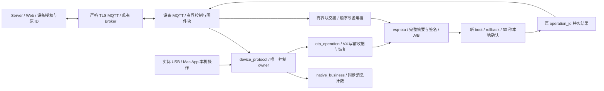

# ESP Base

基于锁定 ESP-IDF 的 ESP32-C3／ESP32 原生业务固件。目标是低资源设备的公网管理与 OTA：**复用严格 TLS MQTT 连接进行控制与分块传输，沿用签名 A/B OTA、rollback 和原操作 ID 持久结果**。原生消息计数业务直接编译进 app，动态运行引擎、独立业务包与联合包 OTA 已退出。

设备通过 MQTT 承载认证控制和完整签名固件数据。设备源码已接通 MQTT 认证二进制块、单块交接与实际 Flash 写入确认，并严格迁移旧配置。双目标依赖锁已由 Component Manager 全新解析；独立离线测试键签名构建和官方公钥验签通过。Server/Web/App 已完成软件消费者接线；**生产签名候选、线上部署和实板仍待验收**，测试键制品不用于刷板，现役设备仍是旧架构。

动态计划与全部限定证据统一见 [ESP 统一交付 #35](https://github.com/darren-you/darren-space/issues/35)，稳定方法见[原生业务与 MQTT OTA 验收合同](docs/operations/ota-allocation-diagnostic-checkpoint.md)。[原生软件检查点](docs/operations/native_software_checkpoint.md)保留旧组合结果；真实 App／USB、公网、双板容量／断电／百次／连续 72 小时资格须对应最终候选重新判断。实板接线见[受控实板接入说明](https://github.com/darren-you/esp-tool/blob/master/docs/operations/hardware-lab.md)。

## 目标运行链路

上图是完整目标链路，设备侧已完成软件接线。块接收不在 RAM 拼接完整镜像，也不新增 Flash 中转副本；设备写入后才推进应用层确认，Broker PUBACK 不作为写入或升级成功证明。完整签名镜像核验通过后才切换启动槽，最终成功还须新 boot 的持久收据及独立固件身份查询。

Mac App 继续只管理本机实际 USB。当前有线 OTA 保留 USB 发 URL 命令、设备 HTTPS 拉取；官方有线刷写／恢复另用于首次布局装配，不能将 URL 命令称为全 USB 固件传输。新公网 OTA 的完整固件字节须走 MQTT，并在 Mac 数据连接移除后验证。

## 分区与存量边界

两个 4 MiB 目标的 app 槽均为 `0x1e0000`。C3 保留 11 页 `base_store` 与闲置数据区 `0x3e5000/0x10000`；ESP32 保留六页 `base_store`、闲置数据区 `0x3ea000/0x10000` 和只读 `at_old_raw@0x3e5000/0x5000`。网络实现改变不授权普通 app OTA 改分区、重用旧区或清空 NVS；现有身份、配置、revision、有效凭据和 V4 收据仍需兼容与恢复验证。仓库删除也不等于现役设备或共享服务已迁移。

## 开发入口

先按 [SDK 与工具说明](tools/README.md)准备仓外 SDK，使用 [sdk-lock.json](sdk-lock.json)核对 IDF／lwIP／TLSF 基线及正式容量统计派生。目标通过 Component Manager 精确消费 MQTT／OTA，不从相邻 checkout 导入实现。[组件清单](firmware/components/device_protocol/idf_component.yml)、[C3 锁](firmware/dependencies.lock)及 [ESP32 锁](firmware/dependencies.lock.esp32)均由官方依赖解析器生成，OTA 固定到带实际写入确认接口的完整提交。全新解析后仍须核对实际锁值与下载源码，不能仅凭 reconfigure 成功判断升级生效。

- [固件构建与现有架构](firmware/README.md)
- [现有设备协议](docs/design/device-protocol.md)
- [宿主回归](firmware/tests/README.md)
- [固件独立 OTA 与恢复](firmware/components/ota_operation/README.md)
- [设备控制与签名固件打包](tools/README.md)

源码说明与唯一协议正文描述当前设备实现；生命周期验证必须使用正式 Server 的 MQTT 调度，不能用历史宿主工具代替。资源门保持内部历史堆至少 16,384 B、最大连续块至少 24,576 B、每个实际任务栈余量至少 1,024 B；须在双板 Wi-Fi／TLS MQTT／原生业务／分块 OTA 同存峰值下实测，软件构建不授予资源、功耗或运行资格。
