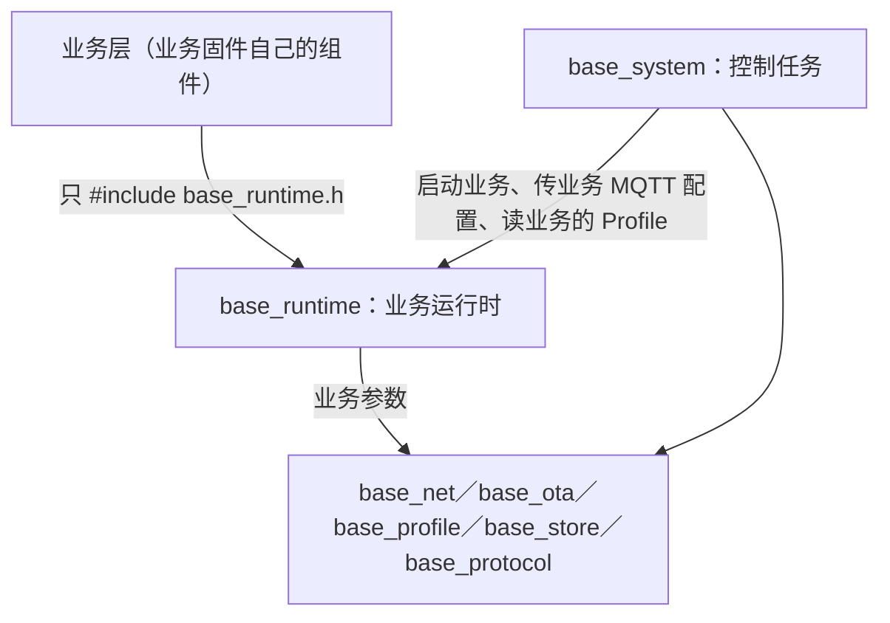

# ESP Base 固件

构建、签名和刷写步骤见[仓库 README](../README.md)，协议见[设备—云协议](../docs/design/device-protocol.md)。工程结构遵循 [Embedded Firmware 工程标准](https://github.com/darren-you/darren-space/blob/master/harness/docs/workspace/standards/embedded-firmware/embedded-firmware-golden-path.md)。

## 目录

| 路径 | 层 | 内容 |
| --- | --- | --- |
| `apps/esp_base/main` | 入口 | 基座固件入口：把 WASM 宿主（`base_wasm_business`）作为业务层交给 `base_system_run` |
| `components/base_system` | 系统 | 主程序：控制任务、系统 MQTT、状态文档发布、命令执行、配置试用、OTA 编排，以及业务守卫（安全模式） |
| `components/base_profile` | 系统 | 设备 Profile 的唯一来源：启动时采集芯片、MAC、IDF 版本，采样任务异步采样堆、系统任务栈、Wi-Fi 与 IPv4／IPv6，并向业务运行时读取业务部分；状态文档与遗嘱都按它的快照编码 |
| `components/base_protocol` | 系统 | 主题、命令解码、应答与去重，Profile 结构及状态文档／遗嘱的编码；纯逻辑，不依赖 ESP-IDF |
| `components/base_ota` | 系统 | OTA 状态机（纯逻辑）和基于 `esp_https_ota` 的下载任务 |
| `components/base_store` | 系统 | NVS 中的设备 UUID、Wi-Fi／系统 MQTT／业务 MQTT 配置、设备名称与所属 Group、OTA 记录和业务守卫记录 |
| `components/base_net` | 系统 | Wi-Fi STA、IPv6（链路本地与 SLAAC）与 SNTP |
| `components/base_runtime` | 运行时 | 业务层唯一能依赖的组件：公开目录里只有 `base_runtime.h`；`system/` 是留给系统层的接口和业务守卫的纯逻辑 |
| `components/base_wasm` | 业务 | WASM 宿主：以一个业务的身份跑在 `base_runtime` 上，用 WAMR 解释器运行编译成 WASM 的业务应用，并负责应用的部署。`core/` 是不依赖 ESP-IDF 的纯逻辑（宿主接口与事件分发、应用包解析、部署状态机）；`base_wasm.c` 是应用任务，`wasm_platform.c` 是定时器与业务 MQTT，`wasm_store.c` 是应用槽、部署记录和下载 |
| `partitions/partitions.csv` | | 两个目标共用的 4 MiB 分区表 |
| `tests` | | host 测试、QEMU 里的部署测试、测试用的应用（`apps/`，源码在 [`../sdk/rust`](../sdk/rust/README.md)）和测试固件的 sdkconfig 片段 |

## 分层



- 系统层的组件互相可见，业务组件只声明 `REQUIRES base_runtime`。`base_runtime` 的公开目录里只有业务接口，它对系统组件的依赖都是私有的，所以业务代码 `#include` 不到系统的配置、存储和协议头文件；系统层用的 `base_runtime/system` 由系统组件在自己的 `CMakeLists.txt` 里显式加入。
- 优先级：系统任务（控制、Profile 采样、OTA 下载）是 5，与 esp-mqtt 任务的默认值相同；业务任务和业务连接的任务最高 4（`BASE_RUNTIME_PRIORITY_MAX`）。业务任务占满 CPU 时系统仍能应答命令和升级；系统 MQTT 与业务连接同时握手时系统优先。
- 这是代码上的解耦，不是内存隔离：业务写坏内存仍会让整机异常重启，靠下面的安全模式兜底。

## 运行方式

控制任务就是主任务，阻塞在一个事件队列上。Wi-Fi、SNTP、MQTT 客户端、定时器、OTA 下载任务和业务运行时都只向队列投递事件，没有事件时控制任务不被唤醒。状态文档里的 `wakeups` 是控制任务处理过的事件数，可用来确认空闲时没有周期性唤醒；唯一的周期事件是每 15 分钟一次的状态刷新。

启动顺序：读取运行固件身份 → 读取 NVS → 业务守卫判定并启动业务（调用业务的 `init`）→ 连接 Wi-Fi → SNTP 对时 → 连接 Broker → 调用业务的 `connect`。TLS 用 ESP-IDF 自带的根证书包校验证书链和主机名，所以必须先对时。

## 安全模式

业务守卫（`base_runtime/system/base_guard.h`，纯逻辑）在每次启动时判定要不要拉起业务：

- 同一个固件连续 3 次异常重启（`panic`、各类看门狗，以及业务任务看门狗超时或业务回调超时后运行时主动重启的 `business_watchdog`），就不再调用任何业务代码。状态文档里 `business.state` 为 `disabled`、`error` 为 `crash_loop`，串口打印 `ESP_BASE_BUSINESS_DISABLED`；系统 MQTT、命令、远程配置和 OTA 照常。
- 正常重启（上电、`restart` 命令、有线刷写）或换了固件后重新计数；业务连续运行 5 分钟后也清零。所以在网页里点「重启」会让业务再试一次，升级固件会直接恢复。
- 异常复位只记在出事的那个固件头上（上一次运行的固件摘要留在 RTC 内存里）：新固件崩溃后回滚回来的旧固件不计这一次。
- 计数存在 NVS 的 `biz_guard`；没有异常重启时不产生写入。
- 安全模式下业务的 `init` 也不会被调用，所以硬件必须在引脚保持复位状态时就是安全的。

## 分区与持久数据

```
nvs       0x009000  64 KiB   设备 UUID、配置、OTA 记录、射频校准
otadata   0x019000   8 KiB
phy_init  0x01b000   4 KiB
ota_0     0x020000  1920 KiB
ota_1     0x200000  1920 KiB
coredump  0x3e0000  64 KiB
```

固件 panic 时把 Core Dump 写进 `coredump` 分区（只留最近一次），经 USB 用 `idf.py coredump-info` 读取；`base_system` 显式依赖 `espcoredump`，因为工程只构建入口组件的依赖闭包。

设备 UUID、Wi-Fi 和系统 MQTT 配置在 NVS 的 `base` 命名空间，由 `tools/esp_base.py flash --provision` 生成 NVS 镜像写入；固件出错时不擦除 NVS。系统 MQTT 是 esp-base 连管理 Broker 的那条连接，只能经出厂资料修改。经 `cmd/config` 下发的新 Wi-Fi 先试用，连上 Broker 才保存，120 秒内连不上就恢复旧配置。`cmd/config` 下发的业务 MQTT（`biz_mqtt_uri`、`biz_mqtt_user`、`biz_mqtt_pass`）收到即保存，业务层经 `base_runtime_mqtt_config()` 读取并自己连接；系统层不连接它。

## 业务固件

业务固件是一个独立的 ESP-IDF 工程，按精确提交引用本仓：把 `firmware/components` 加进 `EXTRA_COMPONENT_DIRS`，`SDKCONFIG_DEFAULTS` 先列本仓的 `sdkconfig.defaults`（目标专属的 `.<target>` 会一并加载）再列自己的，分区表与本仓逐字节相同（正式打包时核对）。入口组件依赖 `base_system`，在 `app_main` 里调用 `base_system_run(&业务描述)`；业务组件只声明 `REQUIRES base_runtime`，只 `#include "base_runtime.h"`。

业务描述（`base_business_t`）：

- `name`：业务名，1–23 字节的小写字母、数字和下划线，上报在状态文档的 `business.name`。
- `init()`：启动时、联网之前调用一次，用来把输出脚置到安全状态、读取业务参数、创建任务。
- 两个回调都在系统的控制任务里执行，各自最多 10 秒（`BASE_RUNTIME_CALLBACK_MS`）：卡在里面系统就不能联网、应答命令和升级，所以超时算一次业务故障，运行时重启设备。耗时的工作放到业务任务里做。
- `connect()`：系统 MQTT 首次连上后调用一次（60 秒内连不上则不再等），业务 MQTT 配置经 `cmd/config` 更新后再调用一次；业务据此（重新）建立自己的连接：只通知业务任务，立即返回。

业务接口（`base_runtime.h`）：

| 接口 | 用途 |
| --- | --- |
| `base_runtime_device_id()` | 设备 UUID |
| `base_runtime_param(key, out, size)` | 业务参数：出厂资料里 `business` 对象的字符串值（NVS 的 `business` 命名空间） |
| `base_runtime_mqtt_config(&mqtt)` | 系统代为保存、可以远程配置的业务 MQTT（地址、账户、密码）；业务可以用它，也可以按自己的参数连别的服务器 |
| `base_runtime_task(name, entry, arg, stack, priority, watchdog_ms)` | 创建业务任务（最多 4 个），记在业务名下；`watchdog_ms` 非 0 时任务必须按期调用 `base_runtime_feed()`，否则运行时重启设备并记一次业务故障 |
| `base_runtime_mqtt_open(name, &config)`／`base_runtime_mqtt_close(client)` | 打开／关闭一条业务 MQTT 连接（最多 3 条）。返回官方 esp-mqtt 的 client：业务自己注册事件、`esp_mqtt_client_start`、订阅和发布；运行时只记录连接的名称、地址（不含账户和密码）和是否已连上，随状态文档上报。关闭只能用 `base_runtime_mqtt_close`，并且不能在这条连接自己的事件处理函数里调用 |

连到哪台服务器、连几条、用什么主题都由业务决定。两条连接错开握手：`connect` 在系统 MQTT 连上之后才调用，业务连接的任务优先级又低于系统 MQTT，在单核的 C3 上不会和系统抢握手。业务连接的重连间隔也应与系统连接（5 秒）错开。业务连接的客户端 ID 不能用设备 UUID（系统 MQTT 在用，同一 Broker 上会互相挤下线），也不能用系统 MQTT 的账户和主题。系统层的状态文档、命令、OTA 与业务无关，target 是 `<芯片>/<业务工程名>`，OTA 只在同一 target 之间进行。

构建、签名、刷写和正式打包用本仓的 `tools/`，以 `ESP_BASE_FIRMWARE_ROOT` 指向业务固件根；正式打包另设 `ESP_BASE_APPLICATION_ID` 为 Fast Deploy 身份里的应用 ID。

## WASM 宿主

基座固件的业务层是 WASM 宿主：业务不编进固件，而是编译成 WASM 应用，封装成签名的[应用包](../docs/design/app-package.md)，部署到设备的应用槽里由宿主加载运行。应用用 [Rust SDK](../sdk/rust/README.md) 开发，部署合同见[设备—云协议](../docs/design/device-protocol.md#应用部署)。

- **事件驱动**：应用导出 `app_init` 和 `app_event`。一个应用任务阻塞在事件队列上，定时器、业务 MQTT 和系统的 connect 通知只向队列投递事件，同一时刻只有一次调用在执行，应用里没有线程。
- **宿主接口 v1**（导入模块 `base`）：日志、单调时间与 UTC 时间、4 个定时器、睡眠、业务 MQTT（连接与遗嘱、订阅、发布，消息以事件送达）、业务参数、设备 UUID 与芯片型号、数字引脚读写、PWM。业务 MQTT 的地址和账户留在宿主里，应用拿不到；连接由宿主建立并自动重连，每次连上后重新订阅。接口只增不改，每次新增版本号加一，定义在 `core/wasm_host.c`、`core/wasm_port.h`。
- **引脚**：应用只能按清单 `pins` 里声明的用途使用声明过的引脚，其余一律拒绝；Flash、USB 和下载串口的引脚装不进清单（[规则](../docs/design/app-package.md#引脚)）。输出脚带安全电平：启动后联网之前、应用的代码运行之前，应用停止、出故障、被替换之后，宿主都把引脚保持在安全状态（PWM 引脚为低）。PWM 用 LEDC，频率和分辨率相同的引脚共用一个定时器。
- **故障只停应用**：每次调用有指令预算（死循环会被停下），一次调用里累计最多睡 1000 毫秒，陷阱、越界指针、栈耗尽都只让这一次调用失败。宿主随即停掉应用：输出回到安全电平、取消定时器、替应用发出遗嘱并断开连接，退避后重新启动（5 秒起，每次翻倍，上限 5 分钟）。应用用到的宿主接口固件必须全都有，缺一个就拒绝加载。
- **看门狗**：应用任务带业务运行时的看门狗，最迟每 10 秒报到一次；60 秒没有报到（宿主自己卡住了）时运行时重启设备，引脚随复位回到初始状态，这次重启计入下面的「连续异常重启」。
- **内存**：运行时的内存取自一块池，池的大小是应用清单里的 `memory`，也就是应用的内存上限（不超过 40 KiB）；应用镜像、模块、实例和执行环境都在池里，应用停止时整池归还。线性内存按模块实际用量收缩（要求模块不含 `memory.grow`，并导出 `__heap_base` 与 `__data_end`），没有收缩的模块被拒绝。
- **应用槽**：不在分区表里。启动时把 Flash 末尾空闲的 64 KiB 登记成两个 32 KiB 的数据分区（`app_a`、`app_b`），应用包原样放在槽的开头；每次启动都重新核对包头、清单、签名和摘要，读不出有效的包就当槽是空的。当前槽和最近一次部署任务记在 NVS 的 `app` 命名空间里。
- **部署**：系统层在 `app/desired` 上收到期望应用后交给宿主，宿主把 `app/state` 的内容交回系统发布。新应用下载到没在用的槽，校验通过后停旧启新，稳定运行 30 秒才提交；启动失败、试运行期间出故障或设备第二次重启都回到原来的槽。已提交的应用运行时设备连续两次异常重启（判定与系统的业务守卫相同），下一次启动就不再运行它，宿主照常在线等新的部署：这样停用的是应用，而不是等到第三次由业务守卫把整个宿主关进安全模式。决定由纯逻辑的状态机（`core/wasm_deploy.c`）做出，设备上的代码只执行它给出的动作。

运行时是 [WAMR](https://github.com/wasm-micro-runtime/wasm-micro-runtime) 2.4.6 的经典解释器，由组件管理器按精确提交取回、原样使用（`components/base_wasm/idf_component.yml`），关闭 AOT、WASI、线程和内置 libc，打开线性内存收缩与指令计量。它的 ESP-IDF 端口在 ESP-IDF 6 上有几处问题，都在构建和链接时处理，不改它的源码：

| 问题 | 处理 | 位置 |
| --- | --- | --- |
| 用到 `struct stat`、`renameat` 却没有包含声明 | 强制包含 `port/wamr_idf6.h` | `CMakeLists.txt` |
| 自己设了 `-Wno-format`，缺配套的 `-Wno-format-security` | 补上 | `CMakeLists.txt` |
| 内存保护开启时 ESP-IDF 6 不定义 `MALLOC_CAP_EXEC` | 定义为无效能力；可执行内存只有 AOT 用 | `CMakeLists.txt` |
| 用 `pthread_self()` 取当前线程，在普通 FreeRTOS 任务里断言失败 | 链接时把 `os_self_thread` 换成按任务句柄实现的版本 | `components/base_wasm/CMakeLists.txt` |
| `os_realloc` 在内存块被挪动后可能把数据错位 4 字节 | 运行时用 WAMR 自带的池分配器，不经过它 | `core/wasm_host.c` |

ESP32-C3 上 WAMR 占 Flash 约 57 KB，宿主约 20 KB，引脚和 PWM 带进来的官方 GPIO、LEDC 驱动约 10 KB；宿主常驻的静态内存约 3.8 KB（部署状态、应用状态文档和两个槽的清单），下载和解码用的缓冲只在用的时候分配。应用的内存池用量约等于 `.wasm` 的字节数加线性内存（4 KiB 栈加静态数据），再加 2 KB 左右的运行时开销：样例应用（1,550 字节）用掉 7,392 字节，其中线性内存 4,176 字节；操作引脚的夹具（2,930 字节）用掉 9,312 字节。应用任务的栈最多用到约 2 KB；应用停止后堆回到启动前的水平。

ESP32-C3 实板上系统 MQTT 和业务 MQTT 两条 TLS 连接在线、样例应用运行时的空闲堆（字节，2026-11-18）：

| 配置 | 稳态空闲 | 固件 OTA 下载期间的最低值 |
| --- | --- | --- |
| 内存池 16 KiB、应用任务栈 8 KiB，TLS 固定缓冲 | 92,340 | 25,376 |
| 内存池 8 KiB、应用任务栈 5 KiB，TLS 固定缓冲 | 102,204 | 没量 |
| 同上，加 `CONFIG_MBEDTLS_DYNAMIC_BUFFER`（现行配置） | 147,548 | 79,600 |

固件 OTA 下载本身最多占约 68 KB（HTTPS 会话、23 KB 的 TCP 接收窗口和下载任务）。固定缓冲下每条 TLS 连接常驻约 20 KiB，两条 MQTT 长连接绝大部分时间空闲，所以 `sdkconfig.defaults` 打开了 TLS 动态缓冲：收发缓冲按需分配、用完即还。

## 公网下载

固件经公网（跨境链路常有丢包）用 HTTPS 下载，`sdkconfig.defaults` 为此调了三处 TCP 默认值：接收窗口 23,040 B（默认 5,760 B，链路好时下载被它限速）、开启 SACK、乱序队列放到上限。下载任务（`components/base_ota/ota_worker.c`）连续 20 秒收不到数据就放弃当前连接，退避后从已写入的扇区续传；`esp_https_ota` 自己把读超时当作继续等待，不会结束一条不再送数据的连接。

## 签名与回滚

应用用 RSA-3072（Secure Boot V2 方案）签名，`CONFIG_SECURE_SIGNED_APPS_NO_SECURE_BOOT` 在更新时验签，信任根是当前运行固件签名块里的公钥。bootloader 不验签，也不烧写 eFuse，所以有线刷写始终可用。

`CONFIG_BOOTLOADER_APP_ROLLBACK_ENABLE` 打开。新固件首次启动后有 300 秒连上 Broker，连上才调用 `esp_ota_mark_app_valid_cancel_rollback()`；超时、崩溃或看门狗复位都会回到旧固件。同一任务累计回滚 3 次记为失败。

验证自动回滚时，用 `CONFIG_ESP_BASE_TEST_NO_BROKER=y` 构建一个只联网、从不连接 Broker 的测试固件（额外的 sdkconfig 片段经 `-DSDKCONFIG_DEFAULTS="sdkconfig.defaults;<片段>"` 传入），用同一把键签名后经 OTA 下发。正式打包入口拒绝打开了这个开关的镜像，测试固件验收后从登记库删除。

验证业务看门狗和安全模式时，用 `CONFIG_ESP_BASE_TEST_BUSINESS_PANIC=y`、`CONFIG_ESP_BASE_TEST_BUSINESS_HANG=y` 或 `CONFIG_ESP_BASE_TEST_BUSINESS_INIT_HANG=y` 构建基座固件：它带一个名为 `test_fault` 的业务，每次启动 20 秒后 `abort()`，或不再向看门狗报到（10 秒后运行时重启设备），或 `init` 回调不返回（10 秒后运行时重启设备）。连续 3 次后设备应进入安全模式并保持在线；`restart` 命令让业务再试一次。测试镜像经 USB 写入实验板，验收后写回正式固件；正式打包入口同样拒绝这三个开关。

## 测试

```bash
bash tests/run_host_tests.sh        # 协议、守卫与 OTA 状态机
bash tests/run_wasm_host_tests.sh   # WASM 宿主核心：需要 cmake，经典与快速解释器各跑一遍
python3 ../sdk/sim/test_sim.py      # 本机运行（模拟器）和应用的命令行工具：需要 cmake 和 rustup
```

覆盖协议编解码、命令去重、Profile 编码（名称规则、默认名称、可上报的地址、任务名去重、JSON 转义与最长文档）、业务守卫（连续异常重启、正常重启、稳定运行与换固件），以及 OTA 状态机的断电与停滞续传、重试退避、拒绝、回滚计数、取消和换任务，并用[合同样例](../docs/design/device-protocol-samples.json)核对与 Server 一致。host 测试不写设备；实板验证见仓库 README 的三层验证。

`run_host_tests.sh` 还覆盖应用包的包头与清单解析（含引脚声明和两种芯片的引脚规则），以及部署状态机的首次部署、替换、启动失败与试运行故障的回退、试运行期间设备重启、断电续做、重试退避、取消、换任务、拒绝和连续异常重启后的停用，并用合同样例核对期望应用的解码和应用状态的形状。

`run_wasm_host_tests.sh` 把宿主核心和 WAMR 编到本机，用真实的应用（`tests/apps/*.wasm`）核对宿主接口与事件分发：每个接口的正常路径和参数范围，没有声明的引脚、用途不对的引脚一律被拒绝且不会碰到硬件，睡眠的累计上限；以及每一类应用故障都只停掉应用：死循环、陷阱、栈耗尽、越界指针、缺少的宿主接口、没有收缩的线性内存、截断或改坏的镜像。这些应用由 `../sdk/rust/build_fixtures.sh` 生成，产物随源码一起提交。

`../sdk/sim` 是给业务开发用的[本机运行](../sdk/rust/README.md#本机测试和运行)：宿主核心和应用包的验收规则与设备共用同一份源码，平台服务换成模拟实现，时间是虚拟的。它的测试用同一批应用核对定时器、业务 MQTT、引脚与 PWM、安全电平、各类故障，以及 `app new` 出来的工程能构建、测试和运行。

设备上的部署用 QEMU 测（需要已导出的 ESP-IDF 环境和 Espressif 的 QEMU）：

```bash
python3 tests/wasm_deploy_qemu.py esp32c3   # 或 esp32
```

它构建一个不启动系统层的测试固件（`CONFIG_ESP_BASE_TEST_WASM_DEPLOY`），把八个应用包放进 Flash 镜像，让固件逐个部署：首次部署、重启后恢复、替换成新版本、启动失败回退、签名后被改动的包和别的键签名的包被拒绝、试运行期间出故障回退、部署一个操作引脚和 PWM 的应用并重启、换回不用引脚的应用、再次重启后仍是最后提交的版本。「下载」换成从 Flash 里拷贝，应用槽、验签、试运行、提交、回退、部署记录和引脚走的都是正式的代码。QEMU 不模拟引脚电平：这里核对的是 GPIO、LEDC 驱动的调用都成功、没有报错，读回的电平和占空比要在实板上看。ESP32 的模拟器默认是 v0.0 的芯片，脚本给它一份烧了芯片版本位的 eFuse；它在 `esp_restart` 之后不复位定时器组，测试固件在 ESP32 上改用系统级的软件复位。

要在设备或 QEMU 上量内存，用测试开关 `CONFIG_ESP_BASE_TEST_WASM_BENCH` 构建一个不启动系统层的固件（片段 `tests/sdkconfig.wasm_bench`；在 QEMU 里再加 `tests/sdkconfig.qemu` 让日志走 UART，加 `tests/sdkconfig.wasm_fast` 换成快速解释器对照），串口上每个阶段打印一行 `WASM_BENCH`。固件开着更新时验签，没签名的镜像启动即退出，所以在 QEMU 里运行前也要用任意一把 RSA-3072 键签名。正式打包入口拒绝带这个开关的镜像。
