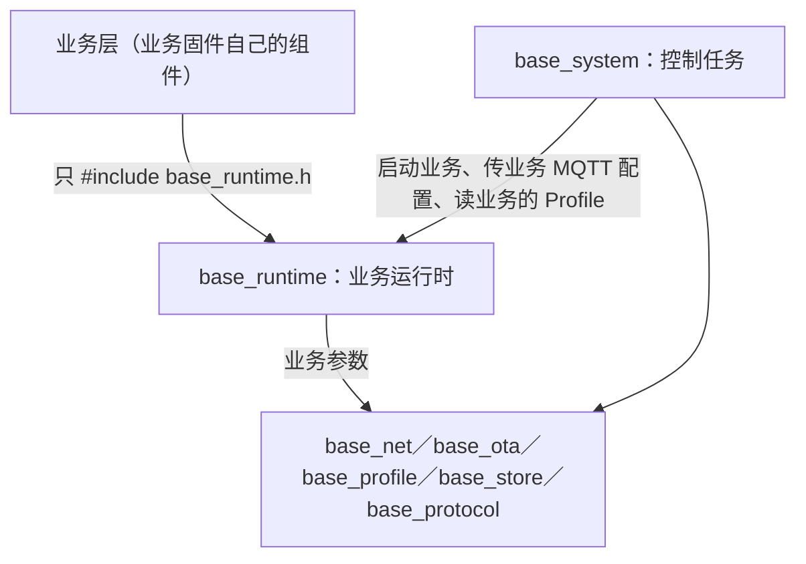

# ESP Base 固件

构建、签名和刷写步骤见[仓库 README](../README.md)，协议见[设备—云协议](../docs/design/device-protocol.md)。工程结构遵循 [Embedded Firmware 工程标准](https://github.com/darren-you/darren-space/blob/master/harness/docs/workspace/standards/embedded-firmware/embedded-firmware-golden-path.md)。

## 目录

| 路径 | 层 | 内容 |
| --- | --- | --- |
| `apps/esp_base/main` | 入口 | 基座固件入口：只调用 `base_system_run(NULL)`，没有业务层 |
| `components/base_system` | 系统 | 主程序：控制任务、系统 MQTT、状态文档发布、命令执行、配置试用、OTA 编排，以及业务守卫（安全模式） |
| `components/base_profile` | 系统 | 设备 Profile 的唯一来源：启动时采集芯片、MAC、IDF 版本，采样任务异步采样堆、系统任务栈、Wi-Fi 与 IPv4／IPv6，并向业务运行时读取业务部分；状态文档与遗嘱都按它的快照编码 |
| `components/base_protocol` | 系统 | 主题、命令解码、应答与去重，Profile 结构及状态文档／遗嘱的编码；纯逻辑，不依赖 ESP-IDF |
| `components/base_ota` | 系统 | OTA 状态机（纯逻辑）和基于 `esp_https_ota` 的下载任务 |
| `components/base_store` | 系统 | NVS 中的设备 UUID、Wi-Fi／系统 MQTT／业务 MQTT 配置、设备名称与所属 Group、OTA 记录和业务守卫记录 |
| `components/base_net` | 系统 | Wi-Fi STA、IPv6（链路本地与 SLAAC）与 SNTP |
| `components/base_runtime` | 运行时 | 业务层唯一能依赖的组件：公开目录里只有 `base_runtime.h`；`system/` 是留给系统层的接口和业务守卫的纯逻辑 |
| `partitions/partitions.csv` | | 两个目标共用的 4 MiB 分区表 |
| `tests` | | host 测试 |

## 分层



- 系统层的组件互相可见，业务组件只声明 `REQUIRES base_runtime`。`base_runtime` 的公开目录里只有业务接口，它对系统组件的依赖都是私有的，所以业务代码 `#include` 不到系统的配置、存储和协议头文件；系统层用的 `base_runtime/system` 由系统组件在自己的 `CMakeLists.txt` 里显式加入。
- 优先级：系统任务（控制、Profile 采样、OTA 下载）是 5，与 esp-mqtt 任务的默认值相同；业务任务和业务连接的任务最高 4（`BASE_RUNTIME_PRIORITY_MAX`）。业务任务占满 CPU 时系统仍能应答命令和升级；系统 MQTT 与业务连接同时握手时系统优先。
- 这是代码上的解耦，不是内存隔离：业务写坏内存仍会让整机异常重启，靠下面的安全模式兜底。

## 运行方式

控制任务就是主任务，阻塞在一个事件队列上。Wi-Fi、SNTP、MQTT 客户端、定时器、OTA 下载任务和业务运行时都只向队列投递事件，没有事件时控制任务不被唤醒。状态文档里的 `wakeups` 是控制任务处理过的事件数，可用来确认空闲时没有周期性唤醒；唯一的周期事件是每 15 分钟一次的状态刷新。

启动顺序：读取运行固件身份 → 读取 NVS → 业务守卫判定并启动业务（调用业务的 `init`）→ 连接 Wi-Fi → SNTP 对时 → 连接 Broker → 调用业务的 `connect`。TLS 用 ESP-IDF 自带的根证书包校验证书链和主机名，所以必须先对时。

## 安全模式

业务守卫（`base_runtime/system/base_guard.h`，纯逻辑）在每次启动时判定要不要拉起业务：

- 同一个固件连续 3 次异常重启（`panic`、各类看门狗，以及业务任务看门狗超时后运行时主动重启的 `business_watchdog`），就不再调用任何业务代码。状态文档里 `business.state` 为 `disabled`、`error` 为 `crash_loop`，串口打印 `ESP_BASE_BUSINESS_DISABLED`；系统 MQTT、命令、远程配置和 OTA 照常。
- 正常重启（上电、`restart` 命令、有线刷写）或换了固件后重新计数；业务连续运行 5 分钟后也清零。所以在网页里点「重启」会让业务再试一次，升级固件会直接恢复。
- 异常复位只记在出事的那个固件头上（上一次运行的固件摘要留在 RTC 内存里）：新固件崩溃后回滚回来的旧固件不计这一次。
- 计数存在 NVS 的 `biz_guard`；没有异常重启时不产生写入。
- 安全模式下业务的 `init` 也不会被调用，所以硬件必须在引脚保持复位状态时就是安全的。

## 分区与持久数据

```
nvs       0x009000  64 KiB   设备 UUID、配置、OTA 记录、射频校准
otadata   0x019000   8 KiB
phy_init  0x01b000   4 KiB
ota_0     0x020000  1920 KiB
ota_1     0x200000  1920 KiB
coredump  0x3e0000  64 KiB
```

设备 UUID、Wi-Fi 和系统 MQTT 配置在 NVS 的 `base` 命名空间，由 `tools/esp_base.py flash --provision` 生成 NVS 镜像写入；固件出错时不擦除 NVS。系统 MQTT 是 esp-base 连管理 Broker 的那条连接，只能经出厂资料修改。经 `cmd/config` 下发的新 Wi-Fi 先试用，连上 Broker 才保存，120 秒内连不上就恢复旧配置。`cmd/config` 下发的业务 MQTT（`biz_mqtt_uri`、`biz_mqtt_user`、`biz_mqtt_pass`）收到即保存，业务层经 `base_runtime_mqtt_config()` 读取并自己连接；系统层不连接它。

## 业务固件

业务固件是一个独立的 ESP-IDF 工程，按精确提交引用本仓：把 `firmware/components` 加进 `EXTRA_COMPONENT_DIRS`，`SDKCONFIG_DEFAULTS` 先列本仓的 `sdkconfig.defaults`（目标专属的 `.<target>` 会一并加载）再列自己的，分区表与本仓逐字节相同（正式打包时核对）。入口组件依赖 `base_system`，在 `app_main` 里调用 `base_system_run(&业务描述)`；业务组件只声明 `REQUIRES base_runtime`，只 `#include "base_runtime.h"`。

业务描述（`base_business_t`）：

- `name`：业务名，1–23 字节的小写字母、数字和下划线，上报在状态文档的 `business.name`。
- `init()`：启动时、联网之前调用一次，用来把输出脚置到安全状态、读取业务参数、创建任务。
- `connect()`：系统 MQTT 首次连上后调用一次（60 秒内连不上则不再等），业务 MQTT 配置经 `cmd/config` 更新后再调用一次；业务据此（重新）建立自己的连接。在控制任务里调用，不要阻塞。

业务接口（`base_runtime.h`）：

| 接口 | 用途 |
| --- | --- |
| `base_runtime_device_id()` | 设备 UUID |
| `base_runtime_param(key, out, size)` | 业务参数：出厂资料里 `business` 对象的字符串值（NVS 的 `business` 命名空间） |
| `base_runtime_mqtt_config(&mqtt)` | 系统代为保存、可以远程配置的业务 MQTT（地址、账户、密码）；业务可以用它，也可以按自己的参数连别的服务器 |
| `base_runtime_task(name, entry, arg, stack, priority, watchdog_ms)` | 创建业务任务（最多 4 个），记在业务名下；`watchdog_ms` 非 0 时任务必须按期调用 `base_runtime_feed()`，否则运行时重启设备并记一次业务故障 |
| `base_runtime_mqtt_open(name, &config)`／`base_runtime_mqtt_close(client)` | 打开／关闭一条业务 MQTT 连接（最多 3 条）。返回官方 esp-mqtt 的 client：业务自己注册事件、`esp_mqtt_client_start`、订阅和发布；运行时只记录连接的名称、地址（不含账户和密码）和是否已连上，随状态文档上报 |

连到哪台服务器、连几条、用什么主题都由业务决定。两条连接错开握手：`connect` 在系统 MQTT 连上之后才调用，业务连接的任务优先级又低于系统 MQTT，在单核的 C3 上不会和系统抢握手。业务连接的重连间隔也应与系统连接（5 秒）错开。业务连接的客户端 ID 不能用设备 UUID（系统 MQTT 在用，同一 Broker 上会互相挤下线），也不能用系统 MQTT 的账户和主题。系统层的状态文档、命令、OTA 与业务无关，target 是 `<芯片>/<业务工程名>`，OTA 只在同一 target 之间进行。

构建、签名、刷写和正式打包用本仓的 `tools/`，以 `ESP_BASE_FIRMWARE_ROOT` 指向业务固件根；正式打包另设 `ESP_BASE_APPLICATION_ID` 为 Fast Deploy 身份里的应用 ID。

## 公网下载

固件经公网（跨境链路常有丢包）用 HTTPS 下载，`sdkconfig.defaults` 为此调了三处 TCP 默认值：接收窗口 23,040 B（默认 5,760 B，链路好时下载被它限速）、开启 SACK、乱序队列放到上限。下载任务（`components/base_ota/ota_worker.c`）连续 20 秒收不到数据就放弃当前连接，退避后从已写入的扇区续传；`esp_https_ota` 自己把读超时当作继续等待，不会结束一条不再送数据的连接。

## 签名与回滚

应用用 RSA-3072（Secure Boot V2 方案）签名，`CONFIG_SECURE_SIGNED_APPS_NO_SECURE_BOOT` 在更新时验签，信任根是当前运行固件签名块里的公钥。bootloader 不验签，也不烧写 eFuse，所以有线刷写始终可用。

`CONFIG_BOOTLOADER_APP_ROLLBACK_ENABLE` 打开。新固件首次启动后有 300 秒连上 Broker，连上才调用 `esp_ota_mark_app_valid_cancel_rollback()`；超时、崩溃或看门狗复位都会回到旧固件。同一任务累计回滚 3 次记为失败。

验证自动回滚时，用 `CONFIG_ESP_BASE_TEST_NO_BROKER=y` 构建一个只联网、从不连接 Broker 的测试固件（额外的 sdkconfig 片段经 `-DSDKCONFIG_DEFAULTS="sdkconfig.defaults;<片段>"` 传入），用同一把键签名后经 OTA 下发。正式打包入口拒绝打开了这个开关的镜像，测试固件验收后从登记库删除。

## 测试

```bash
bash tests/run_host_tests.sh
```

覆盖协议编解码、命令去重、Profile 编码（名称规则、默认名称、可上报的地址、任务名去重、JSON 转义与最长文档）、业务守卫（连续异常重启、正常重启、稳定运行与换固件），以及 OTA 状态机的断电与停滞续传、重试退避、拒绝、回滚计数、取消和换任务，并用[合同样例](../docs/design/device-protocol-samples.json)核对与 Server 一致。host 测试不写设备；实板验证见仓库 README 的三层验证。
