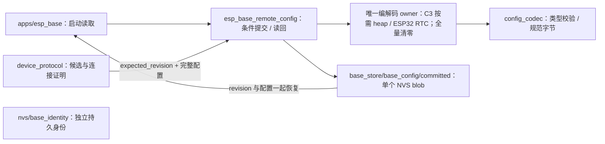

# remote_config

拥有完整配置、单调 revision 和 NVS 提交边界。候选验证由单一控制任务调度，本组件只在连接证明成立后提交。

C3 在一次 load、规范字节消费或完整 commit 中只申请一份 7618 B 编解码缓冲，commit 的前值读取、编码、写入和独立读回复用同一 owner；返回前清零释放。OOM 不开始 NVS 操作，读取与 committed 输出保持，工作配置清零。ESP32 保留已有 RTC 缓冲。C3 长期 context 由 device_protocol 放在 RTC，并在每次启动加载前清空、从 NVS 恢复；RTC 不作为持久事实。双目标故障回归及 C3 实板边界见[软件验证入口](../../../docs/operations/native_software_checkpoint.md#固件与工具)。

## 架构拓扑

USB `config.set` 使用 schema_version 4，精确包含 wifi、mqtt、business；business 必须为 null。Wi-Fi 为 null，或含 ssid、password 的精确对象；SSID 为 1–32 个 UTF-8 字节，密码为 8–63 个可打印 ASCII 字符或 64 位十六进制 PSK，接入至少 WPA2-Personal。MQTT 为 null，或含 hostname、port、username、password、ca_pem、management_key_hex 的精确对象。字段均由物理 USB 注入，不生成或轮换凭据；仅保存配置不等于客户端 ready。新写接口拒绝旧 schema 和任何额外字段。

持久存储继续使用既有 `base_store/base_config/committed` 的单个 v3 EBCF blob，保留原 revision 和 Wi-Fi/MQTT 逐字节内容；退役扩展标志、长度、端口与保留字段全部为零。规范 blob 最大 4901 B，旧记录读取上限仍为 7618 B。保留 v3 是为了让已有旧签名固件在回退时仍能读取相同配置，USB 接口版本与存储格式版本分别管理。身份 namespace、OTA 收据和分区表不变，闲置 scratch 不读写。

启动读取若遇到含退役扩展的历史 v3，先校验旧记录完整长度、所有字段和保留位，才原位去掉退役字段。迁移不增 revision、不更新 Wi-Fi/MQTT、不新增配置 key；仅写一次，commit 后重新读取并核对完整规范长度和 SHA-256，成功后才向调用者交付配置。再次读取规范记录不写入。v1/v2、损坏／超长／截断记录停止初始化，不能通过丢字段使损坏记录变成有效记录。写入开始后的失败或读回不一致为 storage_uncertain，不在同次启动重试，不清空 NVS；下次启动只按实际保留下来的完整旧／新记录处理。host 故障注入不替代真实断电验收。

写入前重新读取 revision，拒绝冲突和溢出；完整 blob 写入、`nvs_commit` 与读回一致后才成功。失败不回显密码、PEM 或管理密钥；status 仍仅返回现有 revision、能力与资源事实。旧迁移代码读取的 `nvs/base_config/generation` 在已核对实板上不存在，不保留兼容读取或双写。

正式 Base 的启动读取和连接证明后的提交由 `device_protocol` 使用与 OTA 相同的短时 Flash I/O owner。启动读取无法取得 owner 时停止初始化；控制任务在 owner 忙时保留已验证候选，在原试运行期限内下一轮再尝试，不占用工作区也不执行 NVS。提交和读回期间持有 owner；释放失败按 `storage_uncertain` 处理。此软件合同尚未测量最大配置 NVS 提交的单步占用和实板并发时延。

配置候选只在 RAM；没有连接证明不调用写接口。写入开始后的错误为 `storage_uncertain`，不能假设原值未变，也不自动重试；控制任务重新读取真实持久状态并停止后续写命令，待重启重新核验。读取失败或格式损坏停止初始化，不自动擦除。身份 namespace 和分区布局保持不变。

NVS blob 的底层原子更新与掉电恢复使用[官方 NVS 实现](https://docs.espressif.com/projects/esp-idf/en/v6.1/esp32c3/api-reference/storage/nvs_flash.html)。host 故障注入验证调用层的错误语义，不能替代真实断电测试。
